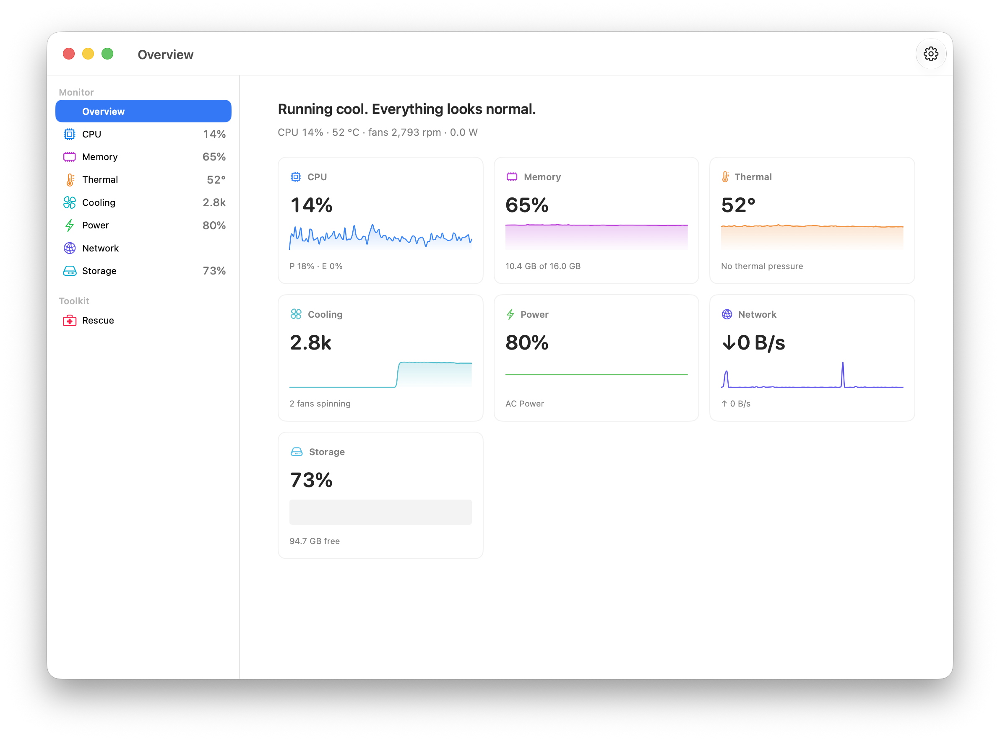
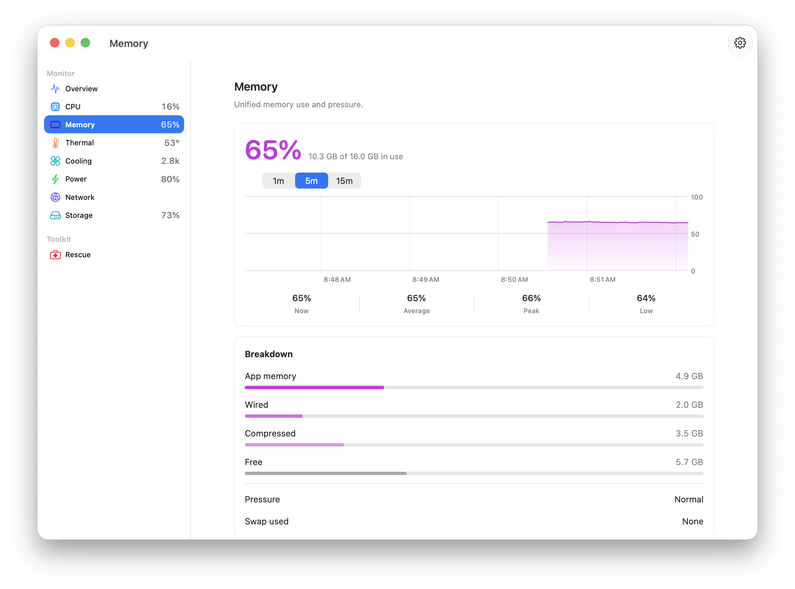
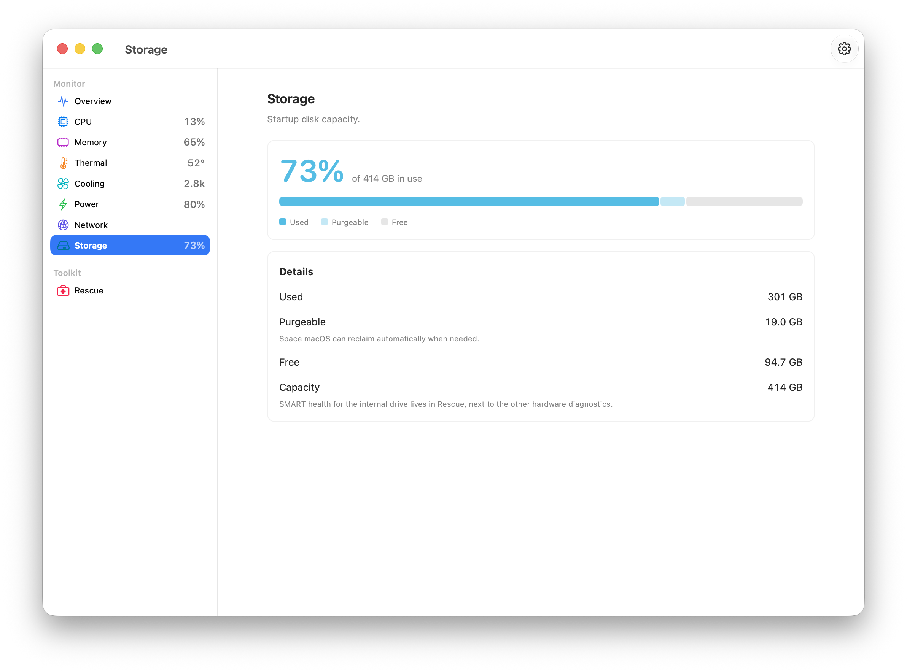
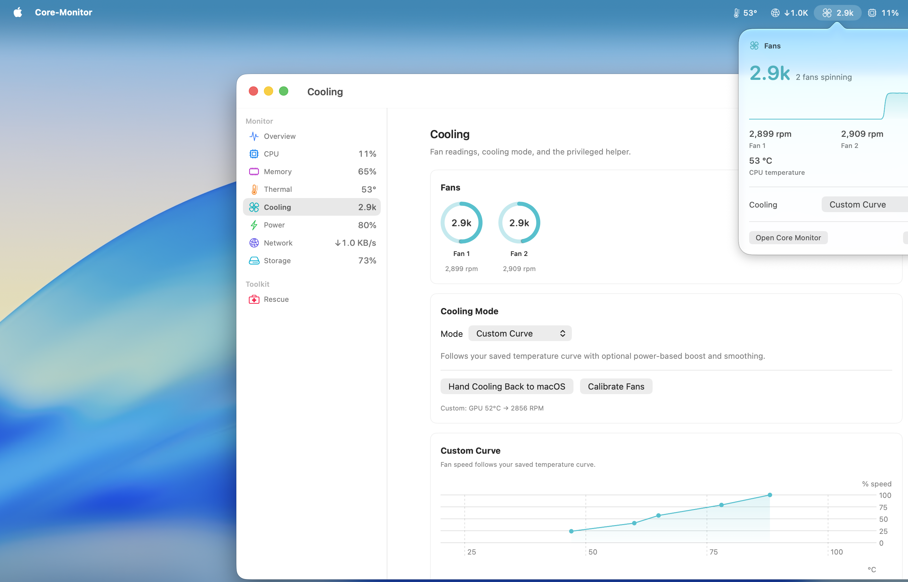
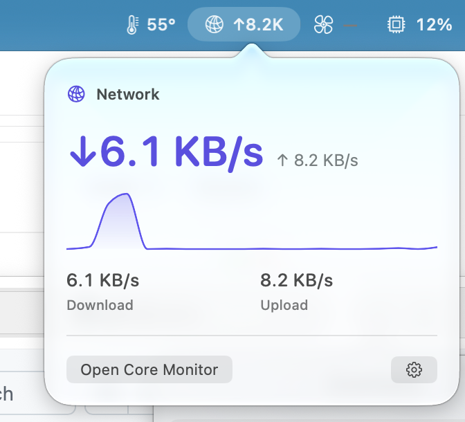
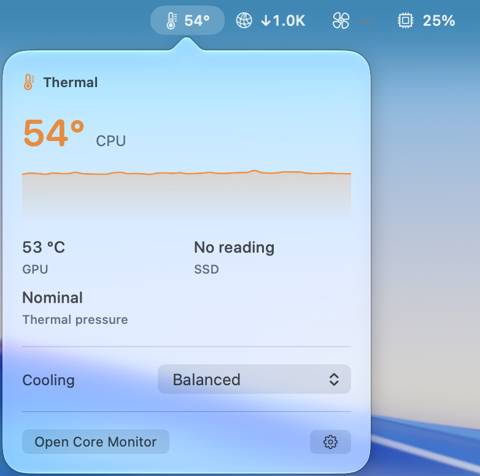

<p align="center">
  
</p>

<h1 align="center">Core-Monitor</h1>

<p align="center">
  A native system monitor and fan controller for Apple Silicon Macs.<br>
  Free, open source, and local. No account.
</p>

<p align="center">
  <a href="https://github.com/offyotto/Core-Monitor/releases/latest/download/Core-Monitor.app.zip"><b>Download</b></a>
  ·
  <a href="https://apps.apple.com/us/app/core-monitor/id6762558526?mt=12">Mac App Store</a>
  ·
  <a href="https://xnu.is-a.dev/">Website</a>
</p>

<p align="center">
  
  
  <a href="https://github.com/offyotto/Core-Monitor/actions/workflows/ci.yml"></a>
  <a href="https://securityscorecards.dev/viewer/?uri=github.com/offyotto/Core-Monitor"></a>
</p>

<p align="center">
  <a href="https://xnu.is-a.dev/#tour"></a>
</p>

<p align="center"><a href="https://xnu.is-a.dev/#tour">Watch the 15-second tour</a></p>

---

## Contents

- [Install](#install)
- [Monitoring](#monitoring)
- [Fan control](#fan-control)
- [Menu bar and Touch Bar](#menu-bar-and-touch-bar)
- [Privacy](#privacy)
- [How it compares](#how-it-compares)
- [Build from source](#build-from-source)

## Install

There are two editions. Both are free.

| | Direct download | Mac App Store |
| --- | --- | --- |
| Monitoring | Full, including Apple SMC sensors | Sandboxed, public APIs only |
| Fan control | Yes, through an optional helper | No |
| Touch Bar widgets | Yes | No |
| Updates | GitHub releases | App Store |

**Direct download:** get [Core-Monitor.app.zip](https://github.com/offyotto/Core-Monitor/releases/latest/download/Core-Monitor.app.zip) from the [latest release](https://github.com/offyotto/Core-Monitor/releases/latest). A `.dmg` is also attached. Each download is about 3 MB.

**Homebrew:**

```bash
brew tap --custom-remote offyotto/core-monitor https://github.com/offyotto/Core-Monitor
brew install --cask offyotto/core-monitor/core-monitor
```

**Mac App Store:** [Core-Monitor on the App Store](https://apps.apple.com/us/app/core-monitor/id6762558526?mt=12). This edition is read-only. See the [App Store edition page](https://xnu.is-a.dev/Mac-App-Store/) for its scope.

Requires macOS 13 or later on an Apple Silicon Mac.

## Monitoring

Core-Monitor shows CPU, GPU, memory, battery, thermals, power draw, fan speeds, network, and disk. Readings come from the Apple SMC and standard macOS system APIs, so the values match what the hardware reports.

If a disk capacity refresh fails, Core-Monitor keeps the last good reading and tries again on the next sample.

<p align="center">
  
  
</p>

## Fan control

The direct download can control fan speeds through a small privileged helper. You can set a fixed speed or make a custom curve. When you turn it off, macOS gets control of the fans again.

- The helper supervises manual targets while the app stays connected and sends a heartbeat.
- If the connection stops or the lease expires, the helper tries to return the fans to automatic control.
- If the SMC fan count is not available, fan detection checks all possible fan slots.
- A failed RPM reading does not cause a low-speed alert. A real 0 RPM reading on a hot Mac can cause a stall alert.

Reinstall the bundled helper when you update. For compatibility and hardware-test limits, see [runtime behavior and validation](docs/development/runtime-safety.md).

<p align="center">
  
</p>

## Menu bar and Touch Bar

- Choose which readings show in the menu bar.
- Open a compact popover for a larger summary.
- Put live widgets on the Touch Bar, if your Mac has one.

The fan value in the menu bar shows `0` when the highest reading is 0 RPM. It shows `—` when no fan reading is available.

<p align="center">
  
  
</p>

## Privacy

No account, no sign-in, no ads, and no analytics. Monitoring data stays on your Mac.

Live weather is off by default. If you turn it on, Core-Monitor asks macOS for location access and gets weather from Apple WeatherKit. The developer never receives that data.

## How it compares

iStat Menus is paid. TG Pro and Macs Fan Control focus mainly on fans. Stats is free but has no fan control. Core-Monitor does monitoring and fan control in one free app, made for Apple Silicon.

## Build from source

1. Clone the repository.
2. Open `Core-Monitor.xcodeproj` in Xcode.
3. Build and run the `Core-Monitor` scheme.

See [CONTRIBUTING.md](CONTRIBUTING.md) before you send a change. Report security problems as described in [SECURITY.md](SECURITY.md).

## License

GPL-3.0. See [LICENSE](./LICENSE).
